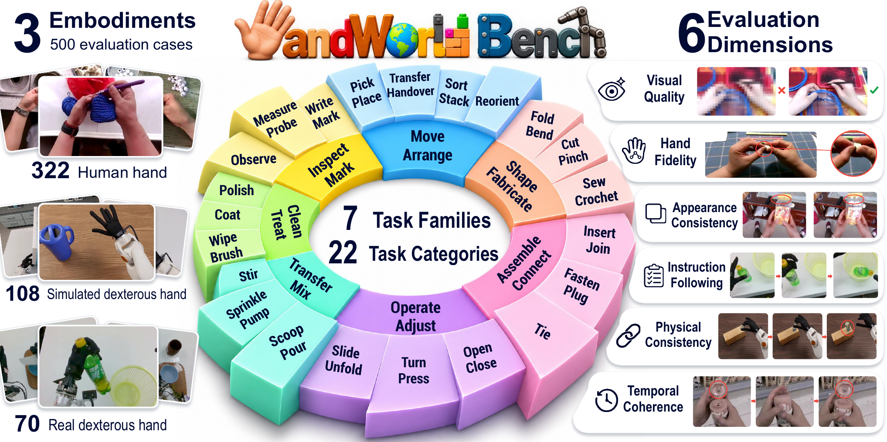

<p align="center">
  
</p>

<h1 align="center">HandWorldBench</h1>

<p align="center"><b>A unified benchmark for hand-centric world models</b></p>

<p align="center">
  <a href="https://arxiv.org/abs/2611.24731"></a>
  <a href="https://embodiedcity.github.io/HandWorldBench/"></a>
  <a href="https://huggingface.co/datasets/EmbodiedCity/HandWorldBench"></a>
  <a href="https://huggingface.co/datasets/EmbodiedCity/HandWorldBench-Corpus"></a>
  <a href="LICENSE"></a>
</p>

HandWorldBench evaluates world models and video generators on hand-object interaction across **human hands,
simulated dexterous hands and real dexterous hands**. We curate 20,500 clips: 500 held-out evaluation cases
covering seven task families and 22 operation categories, and a 20,000-clip training corpus. Seventeen metrics score
six dimensions — visual quality, hand fidelity, appearance consistency, instruction following, physical interaction
and temporal coherence.

This repository contains the **evaluator** and the **data pipeline** (screening, captioning, control rendering) used
to build the datasets.

## Release

| Repository | Content |
| --- | --- |
| [EmbodiedCity/HandWorldBench](https://github.com/EmbodiedCity/HandWorldBench) (this repo) | evaluator, screening, annotation, control-signal generation, tools |
| [HF: EmbodiedCity/HandWorldBench](https://huggingface.co/datasets/EmbodiedCity/HandWorldBench) | 500 evaluation cases (8.7 GB): first frames, prompts, reference videos, hand and camera arrays, control videos, metric annotations |
| [HF: EmbodiedCity/HandWorldBench-Corpus](https://huggingface.co/datasets/EmbodiedCity/HandWorldBench-Corpus) | 20,000 training clips (119 GB) with captions, operation labels and per-frame hand and camera supervision |

| Embodiment | Benchmark cases | Corpus clips |
| --- | ---: | ---: |
| Human hand (egocentric) | 322 | 10,000 |
| Simulated dexterous hand (HandsOn) | 108 | 6,000 |
| Real dexterous hand (TI5) | 70 | 4,000 |

The human clips are egocentric recordings released with the participants' consent; the TI5 data were collected
in-house by the authors and the HandsOn data are simulated. All annotations were verified by human annotators. The
benchmark and the corpus are disjoint at the clip and at the recording / episode level.

## Components

| Directory | What it does | Guide |
| --- | --- | --- |
| `evaluation/` | the 17-metric evaluator (`handworldbench` package, CLI, GPU runtime) | [evaluation/README.md](evaluation/README.md) |
| `data_pipeline/screening/` | clip selection and technical quality screening for the three sources | [screening/README.md](data_pipeline/screening/README.md) |
| `data_pipeline/annotation/` | VLM captions, segment captions and operation labels | [annotation/README.md](data_pipeline/annotation/README.md) |
| `data_pipeline/controls/` | skeleton, surface and X-ray control rendering from hand and camera arrays | [controls/README.md](data_pipeline/controls/README.md) |
| `tools/` | camera-track visualisation and pipeline handoff checks | [tools/README.md](tools/README.md) |
| `docs/` | shared array format and how the stages hand off | [data_format.md](docs/data_format.md), [pipeline.md](docs/pipeline.md) |

## Quick start

```bash
pip install -U huggingface_hub numpy
git clone https://github.com/EmbodiedCity/HandWorldBench && cd HandWorldBench
hf download EmbodiedCity/HandWorldBench --repo-type dataset --local-dir HandWorldBench-data
python HandWorldBench-data/load_clip.py HandWorldBench-data hw500_0001
```

To score your model, generate `<case_id>.mp4` for the 500 cases and follow
[evaluation/README.md](evaluation/README.md) (environments, weights, one command to evaluate).

## Citation

```bibtex
@article{handworldbench2026,
  title   = {HandWorldBench: A Unified Benchmark for Hand-Centric World Models},
  author  = {Wang, Zhaolu and Xu, Jiacheng and Wang, Lihong and Wang, Shuqing and
             Fang, Jianjie and Wang, Ziyou and Liu, Xvyuan and Tang, Rongze and
             Ma, Yiding and Zhang, Xin and Chen, Jiawei and Wu, Wei and Gao, Chen
             and Li, Yong and Chen, Zhibo},
  journal = {arXiv preprint arXiv:2611.24731},
  year    = {2026}
}
```

## License and acknowledgements

The code in this repository is released under the MIT license ([LICENSE](LICENSE)). Both datasets are released under
[CC BY-NC 4.0](https://creativecommons.org/licenses/by-nc/4.0/). Third-party components keep their own licences
([THIRD_PARTY_NOTICES.md](THIRD_PARTY_NOTICES.md)). The evaluator depends on model weights that are downloaded
separately; some of them are gated or licensed for non-commercial use only, and users must follow their terms. MANO,
used to render the human-hand surface controls, is licensed separately by the Max Planck Institute for Intelligent
Systems and is not included.

News and updates: [project page](https://embodiedcity.github.io/HandWorldBench/).
